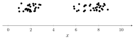
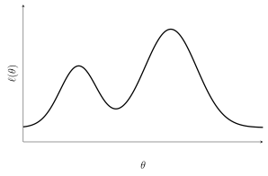
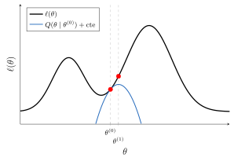
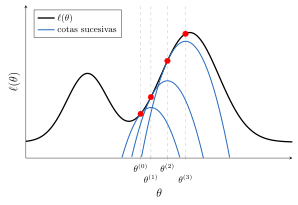
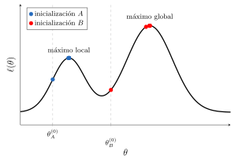

<hr style="border: 1px solid rgba(50, 0, 0, 1);">




<div class="d-flex gap-2">

<a href="../material/apunte_c3s3.pdf" target="_blank" class="btn btn-outline-primary">
<i class="fa-solid fa-file-lines me-2"></i>Versión PDF
</a>

<a href="../material/tp_c3s3.pdf" target="_blank" class="btn btn-outline-success">
<i class="fa-solid fa-clipboard-list me-2"></i>Guía de actividades
</a>

</div>

<div style="margin-top:20px"></div>


En la sección anterior vimos que el modelo de mezcla de gaussianas (GMM) no admite una expresión cerrada para los estimadores de máxima verosimilitud, debido a la presencia de una *variable latente* no observable. En esta sección estudiaremos el *algoritmo EM* (*Expectation-Maximization*), un método iterativo que resuelve este tipo de problemas de manera indirecta: en lugar de maximizar la log-verosimilitud de los datos observados, maximiza repetidamente una esperanza de la log-verosimilitud de los *datos completos*, que sí resulta tratable.

El algoritmo alterna dos etapas: el *paso E* (de esperanza) y el *paso M* (de maximización). Veremos su formulación general, su aplicación a GMM y, finalmente, por qué funciona.


<div style="border-top:1px solid #b7cdf5;
            background-color: #fafbff;
            padding:0.1em 1em;
            margin-top:1.5em;">

📄 **Notación**

Durante esta sección consideramos un conjunto de datos $\{\xx_i\}_{i=1}^n$ de observaciones independientes, cuya distribución depende de un vector de parámetros $\bftheta$. Asociada a cada observación $\xx_i$ hay una variable **latente** $Z_i$, no observable, que toma un número finito de valores.

Denotamos $\ell(\bftheta)$ la log-verosimilitud de los *datos observados* y $\ell_c(\bftheta)$ la de los *datos completos* $(\xx_i, z_i)$. Con $\bftheta^{(t)}$ indicamos el valor de los parámetros en la iteración $t$.

</div>

<div style="margin-top:2.5em;"></div>


## I <span style="color:#CCCCCC;">│</span> Motivación: la variable latente

Trabajemos en una dimensión ($x\in\RR$) y supongamos que recolectamos datos que, al graficarlos sobre la recta real, aparecen como puntos dispersos formando dos grupos separados. Parece razonable suponer que provienen de **dos fuentes gaussianas** diferentes.

<figure style="text-align: center;">
  
  <figcaption> **Figura 3.3.1**. Datos en 1D: dos grupos visibles sobre la recta, lo que sugiere dos fuentes distintas. </figcaption>
</figure>

<div style="margin-top:2em;"></div>

### Si conociéramos las etiquetas

Imaginemos por un momento que supiéramos de qué gaussiana proviene cada punto. Introducimos entonces una variable $Z\in\{1,2\}$ que indica la fuente, de manera que
$$
p(z=j)=\phi_j,\qquad p(x\mid z=j)=\calN(x;\mu_j,\sigma_j^2),\qquad j=1,2,
$$
con $\phi_1+\phi_2=1$. La densidad conjunta de los *datos completos* $(x,z)$ resulta
$$
p(x,z=j;\bftheta) = p(z=j)\,p(x\mid z=j)=\phi_j\,\calN(x;\mu_j,\sigma_j^{2}),
$$
o, escrita de otra manera,
$$
p(x,z;\bftheta)=\left[\phi_1\calN(x;\mu_1,\sigma_1^{2})\right]^{\bfone\{z=1\}}\left[\phi_2\calN(x;\mu_2,\sigma_2^{2})\right]^{\bfone\{z=2\}}.
$$

<div style="margin-top:1em;"></div>

Con esto, la log-verosimilitud de los datos completos es
$$
\begin{align*}
\ell_c(\bftheta) &= \sum_{i=1}^n \log p(x_i,z_i; \bftheta) \\
&= \sum_{i=1}^n \left[ \bfone\{z_i=1\} \Big(\log \phi_1 + \log \calN(x_i;\mu_1,\sigma_1^{2}) \Big)+
\bfone\{z_i=2\}\Big(\log \phi_2 + \log \calN(x_i;\mu_2,\sigma_2^{2})\Big) \right] \\
&= \sum_{i: z_i =1} \Big(\log \phi_1 + \log \calN(x_i;\mu_1,\sigma_1^{2}) \Big)+
\sum_{i: z_i=2} \Big( \log \phi_2  +\log \calN(x_i;\mu_2,\sigma_2^{2})\Big).
\end{align*}
\tag{3.3.1}
$$

<div style="margin-top:1em;"></div>

La expresión (3.3.1) sería fácil de optimizar: para cada observación sobrevive una sola de las dos componentes, de manera que los parámetros de cada gaussiana se estiman por separado, exactamente como en los modelos discriminantes gaussianos de la [C3-S1](C1_gda.html) con clases conocidas.

<div style="margin-top:2em;"></div>

### El problema real

En la práctica **no sabemos** de qué gaussiana proviene cada punto: las etiquetas son **latentes**. Solo observamos $\{x_i\}_{i=1}^n$ sin rótulo, y aun así queremos estimar $\bftheta=(\phi_j,\mu_j,\sigma_j^2)$.

La log-verosimilitud de los datos observados se obtiene marginalizando sobre la variable latente:
$$
\ell(\bftheta) = \sum_{i=1}^n \log p(x_i; \bftheta) = \sum_{i=1}^n \log \sum_{z_i} p(x_i, z_i; \bftheta).
\tag{3.3.2}
$$

<div style="margin-top:1em;"></div>

::: {.myhighlight3}

La suma dentro del logaritmo es la dificultad: impide separar los términos y conduce, en general, a un problema de optimización no convexo sin solución cerrada.

:::

<div style="margin-top:2em;"></div>

Comparando (3.3.1) con (3.3.2) se ve el contraste: conocer $z$ volvería trivial el problema. El algoritmo EM explota precisamente esa observación, reemplazando las etiquetas desconocidas por su valor esperado dado lo que sí observamos.

<div style="margin-top:2.5em;"></div>


## II <span style="color:#CCCCCC;">│</span> El algoritmo EM

La idea es optimizar $\ell(\bftheta)$ de forma **indirecta**, maximizando iterativamente la esperanza de la log-verosimilitud completa, condicionada a los datos observados y evaluada con los parámetros del paso anterior.

<div style="margin-top:1em;"></div>

::: {.definicion}
**Definición 3.3.1.** (Log-verosimilitud esperada) Sea $\bftheta^{(t)}$ el valor de los parámetros en la iteración $t$. Se denomina *log-verosimilitud esperada* a la función
$$
Q(\bftheta\mid \bftheta^{(t)}) := \media\left(\ell_c(\bftheta)\mid \mathbf{x};\bftheta^{(t)}\right) = \sum_{i=1}^n \media\left(\log p(x_i, z_i; \bftheta)\mid \mathbf{x};\bftheta^{(t)}\right).
\tag{3.3.3}
$$

:::

<div style="margin-top:2em;"></div>

Observar que al tomar la esperanza sobre $Z$ condicionando a $\mathbf{x}$, y con los parámetros $\bftheta^{(t)}$ fijos, la variable no observable desaparece de la expresión:

::: {.myhighlight}

$Q(\bftheta\mid \bftheta^{(t)})$ depende únicamente de los datos observados $\mathbf{x}$ y de los parámetros $\bftheta$ y $\bftheta^{(t)}$.

:::

<div style="margin-top:2em;"></div>

Con esto, el algoritmo queda determinado por dos pasos que se alternan:

- **Paso E**: con $\bftheta^{(t)}$ fijo, construir la función $Q(\bftheta\mid \bftheta^{(t)})$.

- **Paso M**: maximizar dicha función respecto de $\bftheta$.

<div style="margin-top:2em;"></div>

<div class="alert alert-light text-dark" role="important">
⚙ <span class="badge bg-custom">Algoritmo EM</span>

---

Dado un *parámetro inicial* $\bftheta^{(0)}$:

<div style="margin-left: 1em">

**repetir** para $t = 0,1,2,\ldots$:

> **1°** (*Paso E*) Calcular $Q(\bftheta\mid \bftheta^{(t)}) = \media\left(\ell_c(\bftheta)\mid \mathbf{x};\bftheta^{(t)}\right)$.
>
> **2°** (*Paso M*) Actualizar $\bftheta^{(t+1)}=\arg\max_{\bftheta} Q(\bftheta\mid \bftheta^{(t)})$.

**hasta** que el criterio de parada se satisfaga.

</div>

---
</div>

<div style="margin-top:2.5em;"></div>


## III <span style="color:#CCCCCC;">│</span> EM para mezcla de gaussianas

Volvamos al modelo de mezcla, ahora en su forma general. Dado un conjunto de datos $\{\xx_i\}_{i=1}^n$ sin etiquetas, modelamos la distribución conjunta $p(\xx_i,z_i)=p(\xx_i\mid z_i)\,p(z_i)$ bajo los siguientes supuestos.

:::{.myhighlight2}

<span style="font-size:0.8em;">*Supuestos del modelo*</span>

<div style="margin-top:-0.5em;"></div>

$$
\begin{array}{c}
Z\sim\text{Multinomial}(1,\bfphi) \\[2pt]
\XX\mid Z=j\sim\calN(\bfmu_j,\Sigma_j)
\end{array}
$$

:::

<div style="margin-top:1em;"></div>

Aquí $\phi_j\geq 0$, $\sum_{j=1}^k \phi_j=1$ y $\phi_j=p(Z=j)$. Cada $\xx_i$ se genera eligiendo aleatoriamente un valor $z_i\in\{1,\ldots,k\}$ y extrayendo luego $\xx_i$ de la gaussiana correspondiente. Las distribuciones conjunta y marginal son
$$
p(\xx_i,z_i)=\prod_{j=1}^k \Big[\phi_j\,\calN(\xx_i;\bfmu_j,\Sigma_j)\Big]^{\bfone\{z_i=j\}},\qquad
p(\xx_i)=\sum_{j=1}^k \phi_j\,\calN(\xx_i;\bfmu_j,\Sigma_j).
$$

<div style="margin-top:2em;"></div>

<div class="alert alert-light text-dark" role="important">
<span class="badge bg-warning text-dark">Importante</span>

¿Quién es $Z$? Es el **índice de la componente** que generó la observación. En aprendizaje no supervisado se lo interpreta como una **clase latente** o *cluster*.

<div style="margin-top:1em;"></div>

Si se quiere una asignación **dura** de cada punto a un cluster, se usa la regla MAP:
$$
\hat z_i=\arg\max_{j}\ p\left(Z_i=j \mid \xx_i\right)=\arg\max_{j}\ \phi_j\,\calN(\xx_i;\bfmu_j,\Sigma_j).
$$

Pero también podemos quedarnos con la asignación **blanda**, es decir, con la probabilidad de pertenecer a cada componente. Esto es lo que usa EM.

</div>

<div style="margin-top:2em;"></div>

### Paso E: las responsabilidades

Con los parámetros $\bftheta^{(t)}$ fijos, la esperanza en (3.3.3) se calcula sobre las indicatrices $\bfone\{z_i=j\}$. Como la esperanza de una indicatriz es la probabilidad del suceso, resulta
$$
w_{ij}^{(t)} := \media\left(\bfone\{z_i=j\}\mid \mathbf{x};\bftheta^{(t)}\right) = \prob(Z_i=j\mid \xx_i;\bftheta^{(t)})
= \frac{\phi_j^{(t)}\,\calN(\xx_i;\bfmu_j^{(t)},\Sigma_j^{(t)})}{\sum_{\ell=1}^k \phi_\ell^{(t)}\,\calN(\xx_i;\bfmu_\ell^{(t)},\Sigma_\ell^{(t)})},
\tag{3.3.4}
$$

donde la última igualdad es la regla de Bayes. Los valores $w_{ij}^{(t)}$ se denominan *responsabilidades*: miden cuánta responsabilidad le cabe a la componente $j$ en haber generado la observación $\xx_i$.

<div style="margin-top:1em;"></div>

Con ellas, la función $Q$ queda
$$
\begin{align*}
Q(\bftheta\mid \bftheta^{(t)}) &= \media\left(\ell_c(\bftheta)\mid \mathbf{x};\bftheta^{(t)}\right) \\
&= \sum_{i=1}^n \media\left( \log p(\xx_i,z_i; \bftheta)\mid \mathbf{x};\bftheta^{(t)}\right)\\
&= \sum_{i=1}^n \sum_{j=1}^k w_{ij}^{(t)} \Big(\log \phi_j + \log \calN(\xx_i;\bfmu_j,\Sigma_j) \Big).
\end{align*}
\tag{3.3.5}
$$

::: {.callout .question}

<span style="font-size: 1.3em;">✍️</span><br>

Compare (3.3.1) con (3.3.5) para $k=2$. ¿Qué rol cumplen las responsabilidades respecto de las indicatrices?

:::

<div style="margin-top:2em;"></div>

### Paso M: las actualizaciones

Maximizando (3.3.5) respecto de $\bftheta$, sujeto a $\sum_j\phi_j=1$, se obtienen las actualizaciones. Definiendo $N_j^{(t)}=\sum_{i=1}^n w_{ij}^{(t)}$, resulta

::: {.myhighlight}

$$
\phi_j^{(t+1)}=\frac{N_j^{(t)}}{n},\qquad
\bfmu_j^{(t+1)}=\frac{1}{N_j^{(t)}}\sum_{i=1}^n w_{ij}^{(t)}\,\xx_i,
$$
$$
\Sigma_j^{(t+1)}=\frac{1}{N_j^{(t)}}\sum_{i=1}^n
w_{ij}^{(t)}\big(\xx_i-\bfmu_j^{(t+1)}\big)\big(\xx_i-\bfmu_j^{(t+1)}\big)^{\top}.
$$

:::

<div style="margin-top:2em;"></div>

::: {.callout .question}

<span style="font-size: 1.3em;">✍️</span><br>

Pruebe que las expresiones anteriores son efectivamente los maximizadores de $Q(\bftheta\mid \bftheta^{(t)})$. Para $\bfphi$, tenga en cuenta la restricción $\sum_{j=1}^k\phi_j=1$.

:::

<div style="margin-top:2em;"></div>

<div class="alert alert-light text-dark" role="important">
<span class="badge bg-success text-light">EM y $K$-medias</span>

Hay un paralelo directo con el algoritmo de $K$-medias de la [C3-S2](C2_clustering.html#k-medias).

<div style="margin-top:1em;"></div>

En $K$-medias, el primer paso asigna cada punto al centroide más cercano: aunque esté apenas más cerca de uno que de otro, la asignación es **dura**, del 100% a ese cluster. EM, en cambio, hace una asignación **blanda**: reparte cada punto entre las componentes según las responsabilidades $w_{ij}$. El segundo paso actualiza las medias en consecuencia, promediando las observaciones con esos pesos en lugar de contarlas enteras.

<div style="margin-top:1em;"></div>

De hecho, si reemplazáramos $w_{ij}^{(t)}$ por $\bfone\{z_i=j\}$ en las actualizaciones del paso M, recuperaríamos exactamente los MLE por clase del modelo discriminante gaussiano, y el algoritmo se volvería muy parecido a $K$-medias.

</div>

<div style="margin-top:2em;"></div>

::: {.callout-example}
<span class="badge bg-primary">Ejemplo 3.3.2</span>
<span style="color: #0d6efd; font-family: Arial; font-weight: bold; font-size: 0.85em;">
EM en una mezcla de dos gaussianas
</span>

Simularemos datos provenientes de una mezcla de dos gaussianas univariadas y aplicaremos el algoritmo EM, mostrando en cada iteración las responsabilidades, la densidad ajustada y el valor de la log-verosimilitud.

```{python}
#| code-summary: "Mostrar código"
#| code-fold: true
#| fig-align: "center"

# (código de la implementación de EM para la mezcla de dos gaussianas)
```

:::

<div style="margin-top:2.5em;"></div>


## IV <span style="color:#CCCCCC;">│</span> ¿Por qué funciona?

Veremos que el algoritmo EM satisface una propiedad de **monotonía**: la log-verosimilitud de los datos observados no disminuye en ninguna iteración. Para probarlo necesitamos primero un resultado auxiliar.

<div style="margin-top:1em;"></div>

### Desigualdad de Jensen

::: {.teorema}
**Teorema 3.3.3.** (Desigualdad de Jensen) Sea $f:I\subset\RR\to\RR$ una función *cóncava*. Para $a_1,\ldots,a_n\in I$ y pesos $q_1,\ldots,q_n\geq 0$ con $\sum_{i=1}^n q_i=1$, se verifica
$$
f\Big(\sum_{i=1}^n q_i a_i\Big)\geq \sum_{i=1}^n q_i\,f(a_i).
\tag{3.3.6}
$$

Si $f$ es estrictamente cóncava, hay igualdad solo si todos los $a_i$ son iguales (salvo pesos nulos).

:::

<details>
<summary><span style="color:#0056b3;">ℹ Ver más información</span></summary>

::: {.panel-tabset}

### <span style="border: 1px solid #ddd; padding: 2px 6px; border-radius: 4px;">*Demostración*</span>

Para $n=2$, la desigualdad es exactamente la definición de concavidad:
$$
f(\lambda a+(1-\lambda)b)\geq \lambda f(a)+(1-\lambda)f(b),\qquad \lambda\in[0,1].
$$

Para $n\geq 3$, sea $s=\sum_{i=1}^{n-1} q_i = 1-q_n$. Si $s=0$ el resultado es trivial. Si $s>0$, definimos
$$
r_i = \frac{q_i}{s},\quad i = 1,\ldots,n-1,\qquad m = \sum_{i=1}^{n-1} r_i a_i,
$$
de manera que $\sum_{i=1}^{n-1} r_i=1$. Por hipótesis inductiva,
$$
f(m)\geq \sum_{i=1}^{n-1} r_i\,f(a_i).
$$

Además, $\sum_{i=1}^{n} q_i a_i = s\,m + q_n a_n$. Aplicando el caso $n=2$ a $m$ y $a_n$:
$$
f\big(s\,m+q_n a_n\big)\geq s\,f(m)+q_n f(a_n)
\geq s\sum_{i=1}^{n-1} r_i f(a_i)+q_n f(a_n)
= \sum_{i=1}^{n} q_i f(a_i),
$$
lo cual prueba el resultado para todo $n$.

<div style="margin-top:-1em;"></div>
<div style="text-align: right;">$\blacksquare$</div>

:::
</details>

<div style="margin-top:2em;"></div>

Dado que $\log$ es cóncava en $(0,\infty)$, el caso que nos interesa es el siguiente.

::: {.myhighlight}

Para $a_i>0$ y pesos $q_i\geq 0$ con $\sum_i q_i=1$,
$$
\log\Big(\sum_{i=1}^n q_i a_i\Big)\geq \sum_{i=1}^n q_i \log(a_i),
$$
con igualdad solo si todos los $a_i$ son iguales.

:::

<div style="margin-top:2em;"></div>

### Propiedad de monotonía

::: {.teorema}
**Proposición 3.3.4.** (Monotonía del algoritmo EM) Sea $\{\bftheta^{(t)}\}$ la sucesión de estimadores generada por el algoritmo EM, es decir, tal que
$$
\bftheta^{(t+1)} = \arg\max_{\bftheta} Q(\bftheta \mid \bftheta^{(t)}).
$$

Entonces
$$
\ell(\bftheta^{(t+1)}) \geq \ell(\bftheta^{(t)})\qquad \forall\, t = 0, 1, 2, \ldots
$$

:::

<details>
<summary><span style="color:#0056b3;">ℹ Ver más información</span></summary>

::: {.panel-tabset}

### <span style="border: 1px solid #ddd; padding: 2px 6px; border-radius: 4px;">*Demostración*</span>

Por la regla de Bayes,
$$
\log p(x;\bftheta) = \log p(x,z;\bftheta) - \log p(z\mid x,\bftheta),
$$
de donde
$$
\ell(\bftheta) = \ell_c(\bftheta) - \sum_{i=1}^n \log p(z_i \mid \xx_i,\bftheta).
$$

Tomando en ambos lados la esperanza condicional de $Z\mid \mathbf{x}$ bajo los parámetros actuales $\bftheta^{(t)}$, y puesto que el lado izquierdo no depende de $z$, resulta
$$
\ell(\bftheta) = Q(\bftheta \mid \bftheta^{(t)}) - H(\bftheta \mid \bftheta^{(t)}),
\tag{3.3.7}
$$
donde
$$
H(\bftheta \mid \bftheta^{(t)}) := \media\left( \sum_{i=1}^n \log p(z_i \mid \xx_i,\bftheta) \,\Big|\, \mathbf{x};\bftheta^{(t)}\right).
$$

De (3.3.7) se obtiene
$$
\ell(\bftheta^{(t+1)}) - \ell(\bftheta^{(t)})
=
\Big(Q(\bftheta^{(t+1)} \mid \bftheta^{(t)}) - Q(\bftheta^{(t)} \mid \bftheta^{(t)})\Big)
-
\Big(H(\bftheta^{(t+1)} \mid \bftheta^{(t)}) - H(\bftheta^{(t)} \mid \bftheta^{(t)})\Big).
\tag{3.3.8}
$$

La primera diferencia es no negativa, porque $\bftheta^{(t+1)}$ se elige de manera que
$$
Q(\bftheta^{(t+1)} \mid \bftheta^{(t)}) \geq Q(\bftheta \mid \bftheta^{(t)})\qquad \forall\, \bftheta.
\tag{3.3.9}
$$

Para la segunda, usando la desigualdad de Jensen para el logaritmo, para cualquier $\bftheta$ se tiene
$$
\begin{align*}
H(\bftheta \mid \bftheta^{(t)}) - H(\bftheta^{(t)} \mid \bftheta^{(t)}) &=
\sum_{i=1}^n \media\left( \log \frac{ p(z_i \mid \xx_i,\bftheta) }{ p(z_i \mid \xx_i,\bftheta^{(t)}) } \,\Big|\, \xx_i;\bftheta^{(t)} \right) \\
&= \sum_{i=1}^n \sum_{z_i} p(z_i \mid \xx_i,\bftheta^{(t)})\,\log \frac{ p(z_i \mid \xx_i,\bftheta) }{ p(z_i \mid \xx_i,\bftheta^{(t)}) }\\
&\leq \sum_{i=1}^n \log \sum_{z_i} p(z_i \mid \xx_i,\bftheta) \\
&= \sum_{i=1}^n \log (1) = 0 .
\end{align*}
\tag{3.3.10}
$$

Finalmente, combinando (3.3.8), (3.3.9) y (3.3.10) se obtiene la monotonía.

<div style="margin-top:-1em;"></div>
<div style="text-align: right;">$\blacksquare$</div>

:::
</details>

<div style="margin-top:2em;"></div>

<div class="alert alert-light text-dark" role="important">
<span class="badge bg-warning text-dark">Importante</span>

La Proposición 3.3.4 implica que si $\{\ell(\bftheta^{(t)})\}$ es una sucesión acotada, entonces converge monótonamente a algún valor $\ell^\star$. Pero esto **no garantiza** que $\ell^\star$ sea un máximo global si la función de verosimilitud no tiene un único máximo.

<div style="margin-top:1em;"></div>

Cuando la verosimilitud es multimodal, lo mejor que se puede garantizar es la convergencia a algún máximo local. En general, el límite de la sucesión de estimadores depende de la elección del punto de partida; por lo tanto, al igual que en $K$-medias, es recomendable considerar varias inicializaciones y quedarse con la que alcance el mayor valor de $\ell$.

</div>

<div style="margin-top:2em;"></div>

### Interpretación geométrica

La descomposición (3.3.7) es la base de todas las formulaciones del algoritmo EM. En particular, permite interpretar el paso M como la maximización de una **cota inferior** de la log-verosimilitud: la función $Q(\bftheta\mid \bftheta^{(t)})$, corregida por un término que no depende de $\bftheta$, nunca supera a $\ell(\bftheta)$ y la toca exactamente en $\bftheta^{(t)}$.

<div style="margin-top:1em;"></div>

::: {.myhighlight}

En cada iteración, EM construye una cota inferior de $\ell(\bftheta)$ que toca a la curva en el parámetro actual, y salta al máximo de esa cota.

:::

<div style="margin-top:2em;"></div>

Las siguientes figuras ilustran el procedimiento.

<figure style="text-align: center;">
  
  <figcaption> **Figura 3.3.2**. La log-verosimilitud $\ell(\bftheta)$ a maximizar. </figcaption>
</figure>

<figure style="text-align: center;">
  
  <figcaption> **Figura 3.3.3**. Paso E en $\bftheta^{(0)}$: la cota $Q(\bftheta\mid \bftheta^{(0)})$ toca a $\ell$ en $\bftheta^{(0)}$. Su máximo define $\bftheta^{(1)}$. </figcaption>
</figure>

<figure style="text-align: center;">
  
  <figcaption> **Figura 3.3.4**. Iteraciones sucesivas: cada cota toca a $\ell$ en el parámetro actual y la secuencia $\bftheta^{(0)}\to\bftheta^{(1)}\to\bftheta^{(2)}\to\cdots$ asciende. </figcaption>
</figure>

<figure style="text-align: center;">
  
  <figcaption> **Figura 3.3.5**. Si $\ell$ tiene múltiples máximos, EM puede converger a uno local según la inicialización. </figcaption>
</figure>

<div style="margin-top:2em;"></div>

Para cerrar, vale remarcar que el algoritmo EM no es exclusivo de las mezclas de gaussianas: proporciona una metodología general para problemas de estimación con variables latentes, y se aplica en contextos tan diversos como los modelos de análisis factorial (que veremos en la próxima sección), la inferencia en modelos bayesianos, la estimación en cadenas ocultas de Markov o el tratamiento de datos faltantes.


<br><br>

::: {.refs}
<span style="color: #444;"><strong>Referencias</strong></span>

Dempster, A. P., Laird, N. M., & Rubin, D. B. (1977). Maximum Likelihood from Incomplete Data via the EM Algorithm. *Journal of the Royal Statistical Society: Series B (Methodological)*, 39(1), 1–22.

Hastie, T., Tibshirani, R., & Friedman, J. (2009). *The Elements of Statistical Learning: Data Mining, Inference, and Prediction*. 2nd ed. Springer Series in Statistics. New York: Springer.

McLachlan, G. J., & Krishnan, T. (2008). *The EM Algorithm and Extensions*. 2nd ed. Wiley Series in Probability and Statistics. Hoboken: Wiley.

Ng, A. (2022). *Stanford CS229: Machine Learning - Lecture Notes*. Standford University. 🔗 [ir al sitio web](https://cs229.stanford.edu/notes2022fall/main_notes.pdf).

:::
